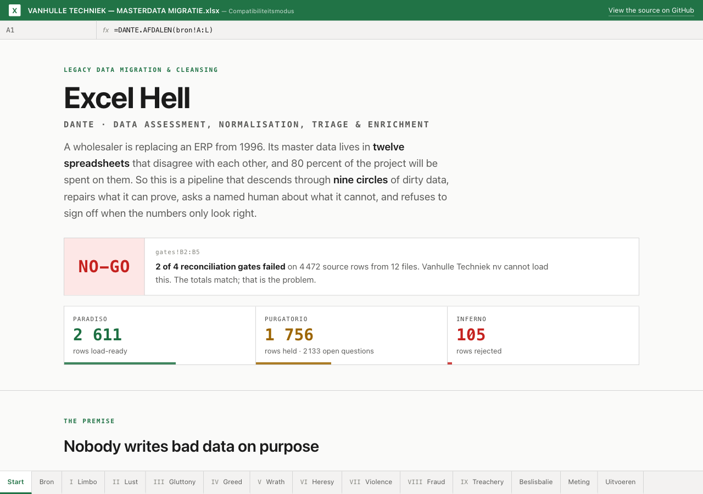
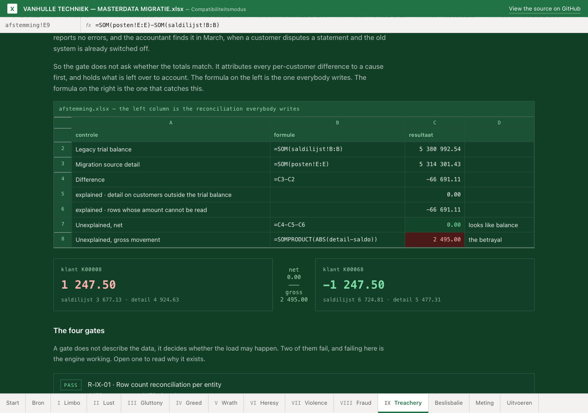

# Excel Hell

**DANTE** — Data Assessment, Normalisation, Triage & Enrichment. A legacy
master-data cleansing pipeline for an ERP migration, built on one claim: the
work is not writing the rules, it is knowing which ones a machine is allowed to
decide on its own.

A fictional Flemish wholesaler is replacing an ERP from 1996. Its master data
lives in twelve spreadsheets that disagree with each other. The pipeline
descends through **9**<!--@circles--> circles of dirty data, repairs what it can
prove, routes what it cannot to the person who owns the answer, and then refuses
to sign off, because the totals only *look* right.

→ **[Walk the descent](https://phlppgdfry.github.io/excel-hell/)** ·
[audit report](https://phlppgdfry.github.io/excel-hell/audit-report.html) ·
[the rule registry](rules/README.md)

[](https://phlppgdfry.github.io/excel-hell/)

```
  PARADISO   2611 rows load-ready
  PURGATORIO 1756 rows held, 2133 decisions for 4 owners
  INFERNO     105 rows rejected

  [pass] R-IX-01  4472 source rows, 4472 placed
  [pass] R-IX-02  source detail 5,314,301.43 vs triaged 5,314,301.43, difference 0.00
  [FAIL] R-IX-03  unexplained difference nets to 0.00 while gross movement is
                  2,495.00 across 2 customers — net zero with gross movement is
                  betrayal, not balance
  [FAIL] R-IX-04  157 customers would arrive with a zero balance, holding
                  884,033.31 between them

  verdict: NO-GO
```

## Why this exists

Most data-quality demos validate data that is already tidy. Real master data is
not tidy, and the reason is never carelessness. A sales rep kept his own
customer list because the ERP was slow. An export is latin-1 because it always
has been. A postcode lost its leading zero the first time the file was opened in
Excel. A VAT number went into the company name because there was no field for
it. Twenty years of individually reasonable decisions is what a migration
actually receives, and it is where most of the project budget goes.

So this repository starts from the filth rather than from the schema.

## Quick start

```bash
uv venv && uv pip install -e ".[dev]"      # or: python -m venv .venv &&
                                           #     .venv/bin/pip install -e ".[dev]"

dante forge           # rebuild the twelve filthy source files from a clean model
dante run             # descend, triage every row, evaluate the gates (exits 1 on NO-GO)
dante report          # render the audit report and refresh the site data

dante rule R-IX-03    # explain one rule and show what it caught
dante why K00008      # why is this one record where it is
dante load            # shape the load-ready data into the target system's tables

dante run --decisions decisions --out out2   # the second pass, with the answers in

pytest -q             # 260 checks: parsers, recall floors, triage, reconciliation,
                      #             the decision loop, the target mapping, the docs,
                      #             and the engine/ground-truth boundary
```

Everything is deterministic from one seed, so every number here is reproducible.

`dante run` exits **0** when every gate passes, **1** when a gate fails, and
**2** when you did something it can tell you how to fix — a missing source file,
the wrong working directory, a report asked for before a run. The middle one is
a result, not a mistake, which is why they are different codes: a dry run that
cannot fail is not a control, and a control that fails the same way as a typo is
not usable in a pipeline.

## The twelve files

Generated from a clean model and then deliberately degraded, which is the point:
because the forge records every defect it plants, the engine's detection rate is
a measurement rather than a claim. The engine never reads that record —
`src/dante/measure.py` does, and it is not part of the pipeline.

| File | What makes it hostile |
|---|---|
| `01_klanten_mercurius.csv` | customer master, semicolon-separated, writes a BOM |
| `02_klanten_verkoop_jan.xlsx` | a rep's own list since 2011; one address cell, no customer numbers |
| `03_klanten_verkoop_sofie.xlsx` | the other rep's list; different columns, several emails per cell |
| `04_klanten_boekhouding.csv` | the accounting export, latin-1, read as UTF-8 downstream |
| `05_artikelen_mercurius.csv` | article master; comma decimals and the occasional `#REF!` |
| `06_artikelen_prijzen_2024.xlsx` | the hand-kept price list, sheet "DEFINITIEF (versie 7)" |
| `07_artikelen_voorraad.xlsx` | stock; article codes Excel decided were numbers |
| `08_artikelen_eenheden.xlsx` | units of measure per the warehouse, disagreeing with the master |
| `09_artikelen_leverancier.xlsx` | primary supplier per purchasing, also disagreeing |
| `10_leveranciers.xlsx` | supplier master, including the blocked ones |
| `11_openstaande_posten.xlsx` | receivables detail plus the legacy trial balance |
| `12_korting_afspraken.xlsx` | discount agreements, some for customers deleted in 2019 |

Total: **4 472**<!--@source_rows--> rows that have to end up somewhere.

## The nine circles

The circles are not decoration, they are the dependency order. You cannot match
duplicates before the names are normalised, cannot reconcile before the money is
parsed, and cannot check a foreign key before you know which records survived.
The engine runs I to IX, and each circle may rely on everything above it and
nothing below it.

| | Circle | The sin | Findings |
|---|---|---|---|
| I | Limbo | data that is almost right — encodings, invisible characters, a BOM | 855 |
| II | Lust | the same customer, five times over, under four spellings | 2 099 |
| III | Gluttony | one cell swallowing a street, a box number, a VAT number and two emails | 552 |
| IV | Greed | money that will not say whether it includes VAT | 4 411 |
| V | Wrath | three sources, three units of measure, one article | 463 |
| VI | Heresy | values that pass every format check and are still false | 141 |
| VII | Violence | what Excel did to the data on its way here | 1 040 |
| VIII | Fraud | keys of the right shape pointing at nothing | 192 |
| IX | Treachery | data that is clean, loads fine and is still wrong | 2 |

**9 755**<!--@findings_total--> findings in total, from
**40**<!--@rules_total--> rules.

## Four things a rule may do

This is the actual design decision in the repository. A rule does not have a
severity, it has an *action*, and the action says who is allowed to decide.

- **repair** — provable from the data, so the engine fixes it and logs the
  original. A stripped leading zero on an EAN is recoverable because the length
  is fixed and the check digit confirms the result.
- **quarantine** — the engine cannot decide, so a named human does. Goes to
  Purgatorio with the evidence attached.
- **reject** — the value is unusable and the row cannot be migrated. Said out
  loud, because a loader that drops it silently is worse.
- **gate** — a run-level control that blocks the whole migration.

The line between the first two is the whole craft. "03/04/2024" is 3 April and
4 March; both are plausible due dates, and guessing is how an aging report
starts lying. So the engine infers the format **per file from the rows that
prove it** — a day past the 12th can only be read one way. The receivables file
contains **586**<!--@date_dmy--> rows proving `dd/mm` and
**75**<!--@date_mdy--> proving `mm/dd`, so its verdict is *mixed*, and its
**404**<!--@ambiguous--> genuinely ambiguous rows go to finance. The document
date in the same file has **655**<!--@date_doc--> proving rows and no
contradiction, so nobody is asked about it.

Rules live in [`rules/rules.yaml`](rules/rules.yaml) as data: an id, a circle,
an action, an owner and a written rationale. CI asserts that every rule fires at
least once, because a rule nobody triggers is documentation, not a control. The
[registry README](rules/README.md) documents the schema and what CI enforces.

## The second pass

A migration is not one descent. The sheets go out, a few people answer what they
can, and it runs again — six times, usually, over two months. An engine that
cannot take those answers back in has produced a report, not a process, and the
business has no way to move the verdict.

So `out/purgatorio/<owner>.csv` goes out with two empty columns on the end, and
`decisions/<owner>.csv` comes back with them filled in. Nothing is retyped,
which matters more than it sounds: retyping is where the second round of
defects comes from.

Three verbs answer one record — `accept`, `correct`, `reject` — and a fourth
kind of answer does something different. "Is this export day-first or
month-first?" is not four hundred questions about four hundred invoices; it is
one question about one file. That is a **ruling**, written once with `*` in
place of a record key:

```csv
rule,entity,key,field,decision,corrected_value,decided_by
R-VII-04,open_item,*,due_date,ruling,dmy,finance
R-II-04,customer,K00008,vat,accept,,finance
R-VI-05,customer,K00150,country,correct,BE,sales
```

Which rules may be answered that way is declared in the registry, and each
answer names the evidence field the finding already published — so a ruling can
only pick between readings the engine itself derived, and cannot invent a value.

The sheets in [`decisions/`](decisions/) are **25**<!--@answered_lines--> lines
across four owners. They close **1 000**<!--@answered_questions--> open
questions:

| | Dry run | After the answers |
|---|---|---|
| Rows load-ready | 2 611 | **3 461**<!--@par_after--> |
| Rows held for a decision | 1 756 | **904**<!--@pur_after--> |
| Open questions | 2 133 | **1 133**<!--@backlog_after--> |
| Customers arriving at a zero balance | 157<!--@wiped_before--> | **17**<!--@wiped_after--> |
| Unexplained gross movement | 2 495.00 | **2 495.00**<!--@gross_after--> |

The last row is the point. R-IX-04 moved because it is a consequence of triage.
R-IX-03 did not move a cent, the verdict is still NO-GO, and that is the
difference between answering a question and fixing a number: the compensating
pair is wrong in the source data, and no amount of sign-off turns two errors
that cancel into one truth.

What an owner may *not* do is overturn a rejection. A `reject` rule says the
record cannot be migrated, not that nobody has looked at it yet — a VAT number
that fails the modulo-97 check does not become valid because a sales manager
signed a sheet. Those lines are refused by file and line number, nothing is
applied, and the run stops. The action says who is allowed to decide, and that
holds for people as firmly as for the engine.

A corrected value has to survive the same parser the engine would have used on
it, and has to reach a column the load file actually carries. Both are checked
before anything is applied, because an answer that quietly does nothing is the
worst of the three outcomes: the run looks like it took it.

One thing it deliberately does not do: a corrected foreign key is not
re-validated inside the same pass. Answers arrive after every circle has had
its say, so a repaired supplier number is checked on the *next* descent. That is
the loop, not a shortcut around it.

## The ninth circle

Two documents, two customers, one amount. One is overstated by exactly as much
as the other is understated. The grand total matches the legacy trial balance to
the cent, every row validates, the loader reports no errors, and the accountant
finds it in March when a customer disputes a statement — by which time the old
system is switched off.

[](https://phlppgdfry.github.io/excel-hell/#ninth)

A net-total reconciliation signs that off. So the gate does not ask whether the
totals match. It attributes every per-customer difference to a cause first, and
then holds the leftover to account:

| | |
|---|---|
| Legacy trial balance | 5 380 992.54<!--@ledger_trial--> |
| Migration source detail | 5 314 301.43<!--@ledger_detail--> |
| Difference | −66 691.11<!--@ledger_diff--> |
| explained: rows whose amount cannot be read | −66 691.11 |
| **unexplained, net** | **0.00** |
| **unexplained, gross movement** | **2 495.00**<!--@gross--> |

Net zero with gross movement is betrayal, not balance, and the run fails.
Failing here is the engine working.

## What it measures about itself

Because the planted defects are known, recall is measurable per rule, and the
test suite holds each rule to a floor. The separation that makes this mean
anything — the engine never reads the file the forge wrote — is not left as a
promise: `tests/test_boundary.py` walks the AST of every module the descent can
reach and fails if one of them names the ground-truth file, imports the scorer,
or calls the generator that knows what the clean data looked like.

**5 993**<!--@detection_found--> of **6 310**<!--@detection_planted--> planted
defects found: **95.0**<!--@recall_overall-->% overall.

The floors themselves were overfit, and the repository caught it. They had been
read off a single seed, so five of them failed the moment the same engine ran on
a different dataset — not because the engine got worse, but because a percentage
on a dozen planted defects is noise. One miss out of twelve moves it eight
points.

So the instrument now depends on the sample. A rule with at least
**100**<!--@stable_sample--> planted defects is held to a percentage floor, set
a few points under the worst recall observed across five seeds. Everything else
is held to an absolute miss budget, because counting misses is the honest thing
to do with a small sample. Which instrument applies is decided from the sample
actually observed in the run, since the forge plants between 94 and 114 defects
for one of these rules depending on the seed. The headline figure is checked
against two further seeds it was never tuned on, and holds between 94.6 and
95.5 percent on every seed tried.

The largest real gap is fuzzy name matching: a company shortened to its first
and last word scores around 68 on `token_sort_ratio`, well under the auto-merge
threshold of 92. Raising the threshold would merge a parent company with its
subsidiary, which costs more than a missed duplicate — so the trade-off is
written in the registry instead of buried in the matcher.

That choice of scorer is itself the bug this repo found in its own first draft.
`token_set_ratio` returns 100 whenever one name's tokens are a subset of the
other's, so "Deveux Bouw" and "Deveux Bouw Zonen" scored a perfect match and
were merged automatically. They are a parent and its subsidiary with separate
credit limits. `token_sort_ratio` scores that pair 79, which lands it in the
grey band where a human belongs.

## What comes out

```
out/
├── paradiso/      load-ready data per entity: ISO dates, numeric amounts, nulled placeholders
├── purgatorio/    one decision sheet per owner, with the evidence and two empty columns
├── inferno/       rejected rows and the rule that rejected them
├── load/          the same data in the target system's tables and field names
└── report/
    ├── audit-report.html   the document the business reads
    ├── run-summary.json    every number on the site and in this README
    ├── findings.csv        every finding, one row each
    └── placement.csv       every source row, where it went and on whose ruling
```

`placement.csv` is what `dante why` reads, and it answers the question a
business owner actually asks during a migration. Never "how many were held" —
always "why is this one":

```
  SAN-0025  (article)
  05_artikelen_mercurius.csv row 26
  → PARADISO, released by operations, who answered R-V-01 with ruling
```

`out/purgatorio/finance.csv` is the deliverable that matters most in practice:
**2 133**<!--@backlog_total--> open questions across four owners, each with the
record, the raw value, the rule and the evidence. Many share one answer — a
single ruling on the date format clears **404**<!--@ambiguous2--> of them, and
one on the price list's "incl VAT" column clears another
**424**<!--@vat_clears-->.

## Where it loads

A clean CSV with a column called `vat` is not load-ready for anything. It is
load-ready for Business Central when it is called `VAT Registration No.`, sits
in a file shaped like the Customer table, and the fields that will not insert
until a setup record exists are named out loud rather than discovered by the
consultant at eleven at night.

So the target is data too, in
[`mapping/business-central.yaml`](mapping/business-central.yaml), and
`dante load` shapes the five entities into the tables a configuration package
expects:

```
     18  Customer              1117 rows  12 fields
     23  Vendor                  58 rows   9 fields
     27  Item                   532 rows  10 fields
   7001  Price List Line        194 rows   8 fields
     81  Gen. Journal Line      710 rows   9 fields
```

Those are the counts from the dry run, so they are load-ready rows rather than
source rows: **2 611**<!--@load_rows--> of **4 472** survive the descent with no
question attached. After the second pass they are higher, which is the whole
reason for running it twice.

The load order is not alphabetical: Business Central validates foreign keys on
insert and refuses an item whose vendor does not exist yet. Open receivables
are not a table at all — they arrive as a general journal batch with a
balancing account, and nothing is open until that batch is posted, which is the
step after this one.

The mapping carries three kinds of entry, and the second and third are the
honest part:

- **`to`** — the field this column becomes.
- **`needs`** — the field exists and the value is not loadable as it stands.
  A payment term of `30` is a number of days in Mercurius and a code with a
  date formula in Business Central. A VAT rate of `21` is a percentage, not a
  posting group. Five fields need a setup record first, and the codes they need
  are listed and checked against the data on every run.
- **`drop`** — the column is not migrated, with the reason written down.
  `created` has nowhere to go: Business Central has no creation date on the
  customer card.

A mapping that only contains the first kind is a mapping somebody wrote without
opening the target.

## Layout

```
src/dante/
├── world.py        the clean model: what the data would have been
├── forge.py        degrades it into twelve files, recording every defect
├── ingest.py       reads them: BOM, latin-1, merged title cells, header by anchor
├── normalise.py    circle I, and the value parsers everything below depends on
├── assemble.py     four customer files onto one candidate shape
├── circles/        one module per circle, c1_limbo … c9_treachery
├── triage.py       three destinations, plus a decision backlog per owner
├── decisions.py    the second pass: what a human answer may and may not do
├── target.py       the load-ready data in the target system's own tables
├── provenance.py   which rules and which values produced this verdict
├── measure.py      scoring against the planted defects (not part of the pipeline)
├── report.py       the audit report and the site data
└── cli.py          forge · run · report · rule · why · load
```

## Provenance

A verdict you cannot tie back to a rule set is not auditable. "The load was
blocked in November" is worth nothing in March unless somebody can say which
forty rules were in force and show that the file on disk today is still that
rule set. So every run records it, the audit report prints it, and the CLI ends
with it:

```
  verdict: NO-GO
  dante 1.0.0 · ruleset 80bdbc04f721 (40 rules) · sources 95ff80efc444
  (13 tables) · 2026-11-05T17:52:35Z
```

Two decisions there look wrong at first and are not.

The source digest is taken over the **values**, not the file bytes. A workbook
opened and saved without a single edit gets new bytes — Excel and openpyxl both
stamp the zip container — and a digest that moves when nothing changed teaches
people to ignore digests. This one is over what came out of the cells, so
re-saving a file is invisible to it and editing one cell is not.

The timestamp honours `DANTE_RUN_AT`, the way a reproducible build honours
`SOURCE_DATE_EPOCH`. Everything else in a run is deterministic from one seed,
and CI holds the committed outputs against a fresh run byte for byte; a wall
clock inside those bytes would fail that check on every commit. The suite
asserts that the clock is the **only** thing that differs between two runs, so
pinning it is a proof rather than an excuse.

## If this ran on real data

Everything here is synthetic, which is convenient in a way worth naming,
because three things change the moment it is not.

**The master data is personal data.** Contact names, email addresses, phone
numbers, and a payment history attached to each one. The decision sheets carry
the raw value alongside the key — that is what makes them answerable — so
`out/purgatorio/sales.csv` is a file of customer contact details sitting in
somebody's downloads folder. Routing by owner is already least privilege by
accident; on real data it has to be least privilege on purpose, and the sheets
need a retention date rather than a lifetime in an inbox.

**Test environments are where this leaks.** A migration is rehearsed four or
five times, and every rehearsal copies production into somewhere with weaker
access control. Pseudonymising names and contact details for every pass except
the final one costs little here, because nothing in circles I to VIII needs a
real email address to find a broken one — only the duplicate matching in circle
II should degrade. Because recall is measured per rule, how much it degrades is
a number you can put in front of a DPO rather than an argument.

**The detection rate would not exist.** The 95.0% on this page is only knowable
because the forge recorded what it planted. On real data there is no answer
key, and any pipeline claiming a recall figure on real data is reporting its
own opinion. What replaces it is a sampled manual review: pull two hundred
records at random, have the owner mark what the engine missed, and publish that
interval with its sample size. Weaker, honest, and the only thing available.

## Known limits

- Matching is deterministic and explainable rather than probabilistic. Splink
  would score better and cannot be defended in a room with the sales manager
  whose credit history was merged away. For this use case that trade is correct;
  for entity resolution at scale it is not.
- Pandera and Pydantic cover the frame and row contracts. Great Expectations
  would add dashboards and governance this case does not need.
- The address parser knows Belgian postcodes and Dutch street conventions. It is
  not internationalised, and it says so rather than guessing.
- Circle IX reconciles receivables only. Stock valuation and open purchase
  orders would each need their own gate.
- It is built for clarity over throughput, and the loop is a literal
  `iterrows()` in most circles. A full descent over 4 472 rows takes about two
  seconds; at a hundred thousand rows that is minutes, and at a million it is
  not usable. Vectorising circle IV alone would cost the line-by-line evidence
  that makes a finding readable, and for a case whose argument is *which
  decisions a machine may make alone*, that is the wrong trade. For a real
  migration at volume it is the right one.
- A corrected value is not re-validated within the same pass. Answers are
  applied after every circle has run, so a repaired foreign key is checked on
  the next descent rather than this one.
- `data/raw/*.xlsx` bytes change on every forge because openpyxl stamps a
  creation time into the zip container, while the data inside is identical. CI
  therefore diff-checks the CSVs, the ground truth and the site outputs only.
  The source digests in the run summary are unaffected, because they are taken
  over the values rather than the bytes.

## Fictional

Vanhulle Techniek nv, Mercurius 4.2, every customer, article and invoice in this
repository are invented, and the source files are generated by `dante forge`.
Any resemblance to a real wholesaler's data quality is a coincidence, and a
likely one.

MIT licensed.
